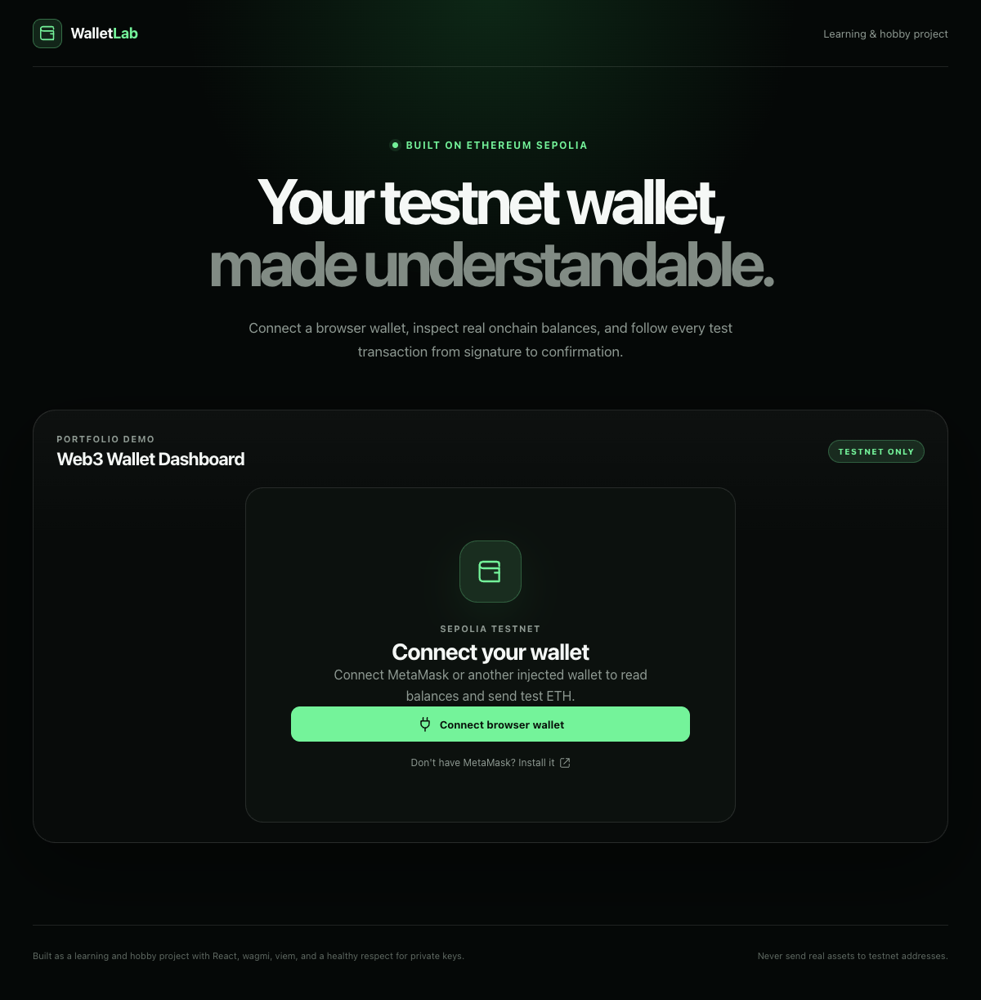

# WalletLab

A learning-focused Ethereum wallet dashboard built with React, TypeScript, wagmi, and viem.

WalletLab is a hobby project I built to understand the browser-wallet integration boundary: connecting an injected wallet, reading onchain state, preparing transactions, requesting signatures, and tracking a transaction until it is confirmed.

It is also intended as a portfolio project. The interface is deliberately polished, but the scope remains small enough that the Web3 mechanics are visible in the code.

> **Testnet only:** WalletLab supports Ethereum Sepolia. Do not send mainnet assets or use a wallet that holds valuable assets while experimenting.



## What it does

- Connects MetaMask or another injected EIP-1193 browser wallet
- Restores wagmi's remembered wallet connection
- Detects account and chain changes
- Blocks transaction features outside Ethereum Sepolia
- Reads the connected account's Sepolia ETH balance
- Sends test ETH through the connected wallet
- Separates wallet approval, broadcast, confirmation, rejection, and failure states
- Reads a configured Sepolia ERC-20 balance (Chainlink LINK)
- Persists transactions initiated by this app in versioned local storage
- Reconciles pending local activity with Sepolia after reloads and temporary RPC failures
- Links addresses, contracts, and transactions to Sepolia Etherscan
- Provides responsive layouts, keyboard focus states, and reduced-motion support

## What it is not

WalletLab is a wallet-connected decentralized application, not a self-custody wallet implementation.

- It does not generate, import, read, or store private keys or seed phrases.
- MetaMask remains responsible for account custody and signing.
- It does not provide complete address history. The activity panel only stores transactions submitted through this app and browser.
- It does not automatically discover every ERC-20 token owned by an address.
- It is not audited and is not intended for production or mainnet use.

## Tech stack

- [React](https://react.dev/) and TypeScript
- [Vite](https://vite.dev/)
- [wagmi](https://wagmi.sh/) for reactive wallet connections and Ethereum hooks
- [viem](https://viem.sh/) for Ethereum types, unit conversion, validation, and contract primitives
- [TanStack Query](https://tanstack.com/query/latest) for query caching and async state
- [Vitest](https://vitest.dev/) and Testing Library
- Plain CSS with no component framework

The implementation uses current wagmi v3 APIs such as `useConnection`, `useConnectors`, and mutation-style `mutate` calls.

## Architecture

```text
React UI
   │
   ├── local form state
   └── versioned app-activity cache
   │
   ▼
wagmi hooks + TanStack Query
   │
   ├── injected wallet connector
   ├── connection and chain state
   ├── balance and contract reads
   └── transaction submission and receipt query
   │
   ▼
viem clients and Ethereum primitives
   │
   ├── public Sepolia RPC transport
   └── MetaMask EIP-1193 provider
   │
   ▼
Ethereum Sepolia
```

The application intentionally does not copy wagmi connection or query data into a second global store. wagmi owns wallet state, TanStack Query owns remote chain data, and React owns temporary UI state.

## Project structure

```text
src/
├── app/                  # wagmi and TanStack Query providers
├── components/           # shared visual primitives
├── features/
│   ├── activity/         # local app-originated transaction activity
│   ├── send/             # ETH send and receipt lifecycle
│   ├── tokens/           # configured ERC-20 reads
│   └── wallet/           # connection, chain guard, overview
├── lib/                  # formatting and transfer validation
├── test/                 # shared test setup
└── web3/                 # wagmi config and error normalization
```

## Getting started

### Requirements

- Node.js 20 or later
- pnpm
- MetaMask or another injected Ethereum browser wallet
- A small amount of Sepolia ETH for transaction testing

### Install and run

```bash
pnpm install
cp .env.example .env.local
pnpm dev
```

Open the local URL displayed by Vite, connect your browser wallet, and switch to Sepolia when prompted.

The `.env.local` file is optional. With no custom RPC URL, wagmi uses Sepolia's public default endpoint.

## RPC configuration

To use a dedicated Sepolia RPC endpoint:

```dotenv
VITE_SEPOLIA_RPC_URL=https://your-sepolia-rpc.example
```

All `VITE_` variables are included in the browser bundle. Never put a private credential or privileged secret in this variable. If your RPC provider treats a browser key as publishable, restrict it by allowed origin and usage limits.

## Getting test tokens

Sepolia ETH and LINK have no intended monetary value.

- Use an established Sepolia faucet for test ETH.
- The configured LINK contract is the official Chainlink Sepolia LINK token:
  `0x779877A7B0D9E8603169DdbD7836e478b4624789`
- The token panel links to the official Chainlink faucet and the contract on Sepolia Etherscan.

Never enter a seed phrase into a faucet or website.

## Scripts

```bash
pnpm dev          # start the Vite development server
pnpm build        # type-check and create a production build
pnpm preview      # preview the production build locally
pnpm lint         # run ESLint
pnpm test         # run the test suite once
pnpm test:watch   # run Vitest in watch mode
```

## Tests

The automated suite covers:

- Address, token amount, and timestamp formatting
- ETH transfer validation and network-fee headroom
- Nested wallet/RPC error normalization
- Versioned transaction storage, account/chain isolation, and malformed data
- Receipt classification and pending-activity reconciliation
- Disconnected, wrong-network, connected-balance, account-change, and RPC-error states
- The disconnected application shell under the real provider composition

Real MetaMask approvals and public Sepolia calls are intentionally not part of deterministic automated tests.

GitHub Actions runs the same lint, test, build, and production dependency-audit checks for pull requests and pushes to `main`.

Before sharing or deploying the project, run:

```bash
pnpm test
pnpm lint
pnpm build
```

## Transaction lifecycle

```text
Draft
  → local validation
  → wallet approval requested
  → transaction submitted (hash available)
  → waiting for receipt
  → confirmed, reverted, or temporarily unknown
```

“Submitted” is not treated as “confirmed.” A transaction only receives the confirmed state when Sepolia returns a receipt whose onchain status is `success`. A reverted receipt is failed. A receipt-query error is temporarily unknown because an RPC outage does not prove onchain failure.

## Local activity storage

The activity cache is scoped by:

```text
chain ID + sender address
```

Values that are `bigint` onchain are serialized as decimal strings because JSON does not support `bigint`. This cache is convenient UI metadata, not an authoritative index of blockchain history. Clearing browser storage removes it without affecting any onchain transaction.

While the connected account is open, submitted and unknown entries are checked against Sepolia every 15 seconds. This also repairs stale activity after a page reload.

## Deployment

The included `vercel.json` adds a restrictive Content Security Policy and other browser security headers for a Vercel deployment. The policy allows the default Sepolia RPC endpoint used by the installed viem chain definition.

If `VITE_SEPOLIA_RPC_URL` points to another origin, add that exact HTTPS origin to `connect-src` in `vercel.json` before deploying. Do not broaden the policy to all HTTPS origins simply to avoid maintaining the allowlist.

Vercel's Git integration can build this Vite application directly. The GitHub Actions workflow performs quality checks only and does not require deployment credentials.

## Security notes

- No private key or seed phrase enters the application.
- Wallet connection and transaction approval require explicit user actions.
- Sending is hard-gated to Sepolia and the chain ID is included in the request.
- Addresses and ETH amounts are validated with viem.
- Raw monetary values remain `bigint`; JavaScript `number` is only used for display formatting.
- User rejection, insufficient funds, RPC failure, reverted receipts, and successful receipts are presented separately.
- The application stores transaction metadata, never wallet secrets.

## Known limitations

- Injected browser wallets only; WalletConnect is not configured.
- Sepolia only.
- One configured ERC-20 token.
- No token transfers, swaps, NFTs, ENS, or smart-account functionality.
- No external indexer, backend, analytics, or complete transaction history.
- A public default RPC can be rate-limited; a dedicated endpoint is preferable for a deployed demo.
- The project has not received a security audit.

## Possible extensions

- Add EIP-6963 multi-wallet discovery UI
- Add WalletConnect for mobile wallets
- Add ERC-20 transfer simulation and execution
- Introduce an explorer/indexer API for complete account history
- Add Playwright tests against a deterministic local chain
- Deploy a small Solidity contract and surface its reads and writes

## Why I built this

Most wallet demos stop at a Connect button. This project explores the less visible parts that matter in a real dApp: chain boundaries, exact-value handling, external wallet state changes, transaction finality, query ownership, failure states, and the distinction between local UI metadata and authoritative onchain data.

It remains a learning and hobby project by design, but it is structured and documented as code I am comfortable presenting in a software engineering portfolio.
